<!-- README do Laboratório 02 (DIW) – baseado no template do Prof. Dr. João Paulo Aramuni -->
<!-- ANTES DE ENVIAR AO GITHUB: troque todos os trechos "SEU_USUARIO", "SEU_REPOSITORIO", "SEU_SOBRENOME" e os links de LinkedIn/e-mail. -->

---

# 🚗 SearchCar – Sistema de Aluguel de Carros 👨‍💻

> [!NOTE]
> Sistema web para **gestão de aluguéis de automóveis**: o cliente escolhe um carro disponível em um catálogo dinâmico e acompanha o status do pedido; o agente (empresa ou banco) analisa, avalia e executa o contrato. Tudo com **HTML, CSS e JavaScript puro**, interface em **Bootstrap 5** e dados persistidos em uma **API REST simulada com JSON Server**.

<table>
  <tr>
    <td width="800px">
      <div align="justify">
        O <b>SuaLocadora</b> é o protótipo desenvolvido no <b>Laboratório 02</b> da disciplina de <i>Desenvolvimento de Interfaces Web (DIW)</i>, do curso de <b>Engenharia de Software da PUC Minas</b>. O sistema permite que <b>clientes</b> se cadastrem, consultem um catálogo de carros disponíveis (com filtros por tipo e faixa de preço), façam pedidos de aluguel e acompanhem o status deles, enquanto os <b>agentes</b> (empresas e bancos) analisam o lado financeiro de cada pedido, emitem parecer e executam o contrato, registrando o automóvel como propriedade da empresa ou do banco. A aplicação é <i>100% front-end</i> (sem back-end próprio): a camada de dados é uma API REST simulada com <b>JSON Server</b>, consumida via <b>Fetch API</b>.
      </div>
    </td>
    <td>
      <div>
        
      </div>
    </td>
  </tr>
</table>

---

## 🚧 Status do Projeto

[](https://github.com/SEU_USUARIO/SEU_REPOSITORIO/releases)


[](#-licença)

       

---

## 📚 Índice
- [Links Úteis](#-links-úteis)
- [Sobre o Projeto](#-sobre-o-projeto)
- [Funcionalidades Principais](#-funcionalidades-principais)
- [Tecnologias Utilizadas](#-tecnologias-utilizadas)
- [Arquitetura](#-arquitetura)
  - [Diagramas](#diagramas)
  - [Modelo de dados](#modelo-de-dados)
  - [Ciclo de vida do pedido](#ciclo-de-vida-do-pedido)
  - [Cálculo do valor do aluguel](#cálculo-do-valor-do-aluguel)
  - [Rotas da API](#rotas-da-api)
- [Instalação e Execução](#-instalação-e-execução)
  - [Pré-requisitos](#pré-requisitos)
  - [Configuração (Variáveis de Ambiente)](#-configuração-variáveis-de-ambiente)
  - [Instalação de Dependências](#-instalação-de-dependências)
  - [Inicialização do Banco de Dados (JSON Server)](#-inicialização-do-banco-de-dados-json-server)
  - [Como Executar a Aplicação](#-como-executar-a-aplicação)
- [Deploy](#-deploy)
- [Estrutura de Pastas](#-estrutura-de-pastas)
- [Demonstração](#-demonstração)
  - [Aplicação Web](#-aplicação-web)
  - [Exemplo de saída no Terminal](#-exemplo-de-saída-no-terminal)
- [Testes](#-testes)
- [Documentações utilizadas](#-documentações-utilizadas)
- [Autores](#-autores)
- [Contribuição](#-contribuição)
- [Agradecimentos](#-agradecimentos)
- [Licença](#-licença)

---

## 🔗 Links Úteis
* 🌐 **Demo Online:** não há versão hospedada. O projeto roda **localmente** (veja [Como Executar a Aplicação](#-como-executar-a-aplicação)).
  > 💻 **Motivo:** a persistência depende do JSON Server, que é uma API de desenvolvimento e precisa estar rodando na máquina.
* 📱 **Download Mobile:** não se aplica (aplicação web responsiva, acessível pelo navegador do celular).
* 📖 **Documentação:** [Pasta `docs/`](./docs) (diagramas UML: casos de uso, classes, pacotes e componentes).
  > 📚 **Descrição:** versões de todos os modelos produzidos ao longo do laboratório.
* 🔌 **API local:** `http://localhost:3000` (JSON Server) · 🖥️ **Front-end local:** `http://127.0.0.1:5500` (Live Server).

---

## 📝 Sobre o Projeto

**Por que existe.** O projeto atende ao enunciado do Laboratório 02 de DIW: desenvolver um sistema de apoio à gestão de aluguéis de automóveis que permita **efetuar, cancelar e modificar pedidos pela Internet**, aplicando HTML5, CSS3, JavaScript, Bootstrap 5 e JSON Server (consumido via Fetch API).

**Qual problema resolve.** Centraliza, em uma interface web, um fluxo que normalmente é disperso: o cliente vê somente os carros **realmente disponíveis**, faz a reserva e acompanha o andamento; o agente enxerga, no mesmo painel, os dados do pedido e a **renda do cliente** para dar um parecer financeiro e, se aprovado, executar o contrato.

**Contexto.** Trabalho acadêmico (Engenharia de Software, PUC Minas, disciplina DIW, Prof. João Paulo Carneiro Aramuni). A avaliação considera a adequação aos requisitos, o **alinhamento entre modelo (classes e arquitetura) e código** e a atualização dos modelos UML.

**Onde pode ser usado.** Como protótipo/estudo de caso de uma locadora ou de uma plataforma que conecta locadoras e bancos (contratos de aluguel associados a crédito).

**Valor entregue.**
- Cliente: catálogo simples, filtro por tipo e preço, detalhes do carro e pedido em poucos cliques.
- Agente: fluxo guiado de análise → parecer → contrato, com registro de **quem passa a ser proprietário** do automóvel (empresa ou banco).

---

## ✨ Funcionalidades Principais

- 🔐 **Cadastro prévio e Login:** o sistema só é usado após o cadastro; cada tipo de usuário (cliente/agente) vai para a mesma home, com **menu adaptado ao perfil**.
- 👤 **CRUD de Cliente:** criar, listar, editar e excluir; guarda RG, CPF (com **validação dos dígitos verificadores**), nome, endereço, profissão e **até 3 entidades empregadoras com rendimentos**.
- 🏠 **Home dinâmica:** hero, **carrossel com carros sorteados** a cada visita (somente disponíveis) e rodapé; responsiva (3, 2 ou 1 card por página).
- 🚘 **Catálogo de carros:** exibe apenas carros disponíveis, na ordem do banco, com **filtro por tipo e faixa de preço**.
- 🔄 **Cards que viram:** "Mostrar detalhes" gira **somente o card clicado** (flip 3D em CSS) para exibir a ficha técnica.
- ♾️ **Rolagem infinita:** novos lotes de cards entram conforme o usuário rola (`IntersectionObserver`) até acabarem os carros.
- 📝 **Pedidos do cliente:** criar (com o carro já selecionado vindo do catálogo), **modificar** (enquanto pendente), **consultar status** e **cancelar**.
- 💰 **Cálculo automático do valor do aluguel:** `valor base + (valor da diária × nº de dias)`, exibido **em tempo real** no formulário de pedido (atualiza ao trocar carro ou datas) e **salvo junto do pedido**, sendo mostrado ao cliente e ao agente nas listas de pedidos.
- 💳 **Crédito opcional:** o pedido pode ser associado a um contrato de crédito concedido por um **banco agente**.
- 🧾 **Painel do agente:** iniciar análise, **aprovar/rejeitar com parecer** (com a renda total do cliente e o valor do pedido à vista) e **executar o contrato**.
- 🏷️ **Propriedade do automóvel:** ao contratar, o carro é registrado como propriedade do **banco** (pedido com crédito) ou da **empresa**.
- 🛡️ **Regras de negócio:** disponibilidade calculada pelos pedidos ativos, bloqueio de e-mail/CPF duplicados, bloqueio de exclusão de cliente com pedidos, datas consistentes, valor do pedido recalculado no momento de gravar, checagem final de disponibilidade antes de gravar.
- 🧱 **Páginas montadas dinamicamente:** menu, tabelas, carrossel e catálogo são gerados por JavaScript a partir da API (subsistema "construção dinâmica das páginas web" do enunciado).

---

## 🛠 Tecnologias Utilizadas

### 💻 Front-end

* **Estrutura e lógica:** HTML5 e JavaScript (ES2022, **ES Modules**, `async/await`, `Fetch API`, `IntersectionObserver`, `sessionStorage`)
* **Estilização:** CSS3 (Grid, Flexbox, variáveis CSS, `transform`/`perspective` para o flip) + **Bootstrap 5.3.3** (via CDN)
* **Gerenciamento de estado:** estado local por página (variáveis de módulo) + sessão do usuário em `sessionStorage`
* **Build Tool:** nenhum (arquivos estáticos servidos diretamente)

### 🖥️ Back-end (API simulada)

* **Linguagem/Runtime:** Node.js 18+ (apenas para executar o JSON Server)
* **Framework:** **JSON Server 0.17.4** (API REST gerada a partir do `db.json`)
* **Banco de Dados:** arquivo `db.json` (coleções `usuarios`, `automoveis`, `pedidos`)
* **Autenticação:** simulada no cliente (busca por e-mail e senha; sessão em `sessionStorage`) — **apenas para fins acadêmicos**

### ⚙️ Ferramentas

* **Servidor local do front-end:** extensão **Live Server** (VS Code) ou `npx serve`
* **Versionamento:** Git e GitHub
* **Modelagem:** diagramas UML (casos de uso, histórias do usuário, classes, pacotes e componentes)

---

## 🏗 Arquitetura

### Visão geral

O sistema é um **front-end estático em camadas**, que conversa por HTTP/JSON com uma API REST simulada. A divisão em módulos ES evita código repetido e mantém o **código alinhado aos diagramas de pacotes e componentes**.

```
┌─────────────────────────────────────────────────────────────┐
│ Pacote  APRESENTAÇÃO  (HTML + CSS + JS de cada página)      │
│ index · cadastro · home · catalogo · pedidos ·              │
│ pedido-form · clientes · agente                             │
└───────────────┬─────────────────────────────────────────────┘
                │ usa
┌───────────────▼─────────────────────────────────────────────┐
│ Pacote  SERVIÇOS COMUNS                                     │
│ auth.js (sessão) · utils.js (validação, alertas, navbar)    │
│ carros.js (disponibilidade, sorteio, imagem)                │
└───────────────┬─────────────────────────────────────────────┘
                │ usa
┌───────────────▼─────────────────────────────────────────────┐
│ Pacote  ACESSO A DADOS                                      │
│ api.js (Fetch API ⇄ REST)                                   │
└───────────────┬─────────────────────────────────────────────┘
                │ HTTP / JSON
┌───────────────▼─────────────────────────────────────────────┐
│ JSON Server  (porta 3000)  →  db.json                       │
└─────────────────────────────────────────────────────────────┘
```

**Subsistemas do enunciado**
1. **Gestão de pedidos e contratos:** `pedidos`, `pedido-form`, `agente`, `clientes`, `cadastro`.
2. **Construção dinâmica das páginas web:** `home`, `catalogo`, `montarNavbar()` e a geração de tabelas/cards por JavaScript.

**Padrões e decisões**
- **Camada de acesso a dados (fachada):** `api.js` esconde URL, headers e JSON; páginas **nunca chamam `fetch` direto**.
- **Módulos ES compartilhados:** regras reutilizáveis (`carros.js`, `utils.js`, `auth.js`) em um só lugar.
- **Disponibilidade derivada:** "carro disponível" **não é gravado**; é calculado a partir dos pedidos com status ativo (Pendente, Em análise, Aprovado, Contratado). Isso evita inconsistência entre carro e pedido.
- **Herança como campo `tipo`:** `Cliente` e `Agente` (especializações de `Usuario`) ficam na mesma coleção `usuarios`, diferenciados por `tipo` (e `tipoAgente`).
- **Delegação de eventos:** um único ouvinte por tabela/grade atende botões criados dinamicamente.
- **Máquina de estados do pedido:** as ações permitidas dependem do status atual (ver abaixo).
- **Valor do pedido como "instantâneo" (snapshot):** o pedido grava `valorBase`, `precoDiaria`, `dias` e `valorTotal`. Se o preço do carro mudar depois, os pedidos já feitos mantêm o valor combinado.
- **Rolagem infinita em memória:** os carros disponíveis são buscados, filtrados no JavaScript e exibidos em lotes de 6.
- **Comparação de ids como texto** (`String(a) === String(b)`): funciona com JSON Server 0.17 (ids numéricos) e 1.x (ids em texto).

**Trade-offs e limitações**
- **Segurança simulada:** senhas em texto puro e controle de acesso apenas na interface. É aceitável em protótipo acadêmico; em produção exigiria back-end com hash de senha e autorização no servidor.
- **Filtros do JSON Server 0.17:** ele **ignora** `?campo=valor` quando nenhum registro da coleção possui aquele campo. Por isso a verificação de CPF/e-mail duplicado é feita no JavaScript, comparando a lista completa.
- **Escalabilidade:** a disponibilidade é calculada no cliente; com milhares de carros o ideal seria o servidor calcular e paginar.
- **Concorrência:** a checagem final de disponibilidade reduz, mas não elimina, a chance de dois usuários reservarem o mesmo carro simultaneamente.

### Diagramas

Os diagramas exportados ficam em [`docs/`](./docs) (cada versão em um arquivo próprio, sem sobrescrever a anterior). Abaixo, o diagrama de classes em Mermaid (renderizado pelo próprio GitHub):

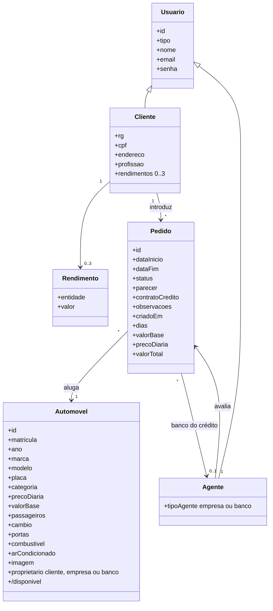

| Diagrama de Casos de Uso | Diagrama de Classes |
| :---: | :---: |
|  |  |
| **Diagrama de Pacotes (Visão Lógica)** | **Diagrama de Componentes** |
|  |  |

> [!NOTE]
> Exporte seus diagramas para `docs/` com os nomes acima (ou ajuste os caminhos nesta tabela).

### Modelo de dados

| Coleção | Campos principais |
| :--- | :--- |
| `usuarios` | `id`, `tipo` (`cliente` \| `agente`), `nome`, `email`, `senha`; cliente: `rg`, `cpf`, `endereco`, `profissao`, `rendimentos[]` (`entidade`, `valor`, máx. 3); agente: `tipoAgente` (`empresa` \| `banco`) |
| `automoveis` | `id`, `matricula`, `ano`, `marca`, `modelo`, `placa`, `categoria`, `precoDiaria`, `valorBase`, `passageiros`, `cambio`, `portas`, `combustivel`, `arCondicionado`, `imagem` (opcional), `proprietario` (`cliente` \| `empresa` \| `banco`), `proprietarioId` |
| `pedidos` | `id`, `clienteId`, `automovelId`, `dataInicio`, `dataFim`, `contratoCredito`, `bancoId`, `observacoes`, `status`, `parecer`, `agenteId`, `criadoEm`, **`dias`, `valorBase`, `precoDiaria`, `valorTotal`** (valores gravados no momento do pedido) |

### Ciclo de vida do pedido

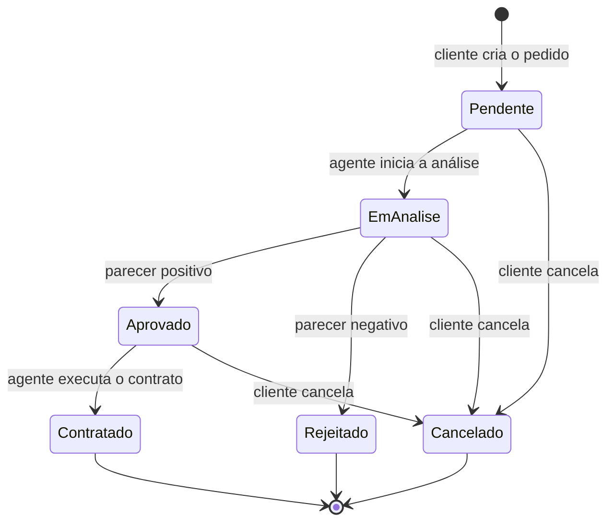

Ao **contratar**, o automóvel passa a ser propriedade do **banco** (se o pedido tem crédito) ou da **empresa** (sem crédito).

### Cálculo do valor do aluguel

```
valorTotal = valorBase + (precoDiaria × dias)
```

| Termo | Origem |
| :--- | :--- |
| `valorBase` | taxa fixa de aluguel do automóvel (`automoveis[].valorBase`) |
| `precoDiaria` | valor por dia do automóvel (`automoveis[].precoDiaria`) |
| `dias` | diferença entre a data de fim e a de início, **mínimo de 1 dia** (retirar e devolver no mesmo dia conta 1 diária) |

**Exemplo:** Fiat Argo (base R$ 60,00 · diária R$ 119,00) de 05/11 a 08/11 → 3 dias → `60 + 119 × 3` = **R$ 417,00**.

- O valor é exibido **em tempo real** no formulário de pedido e **recalculado no momento de gravar** (não se confia só no que está na tela).
- O pedido guarda `valorBase`, `precoDiaria`, `dias` e `valorTotal`; as listas de *Meus pedidos* e do *Painel do agente* mostram o total e a composição.
- As funções `calcularDias()` e `calcularValorAluguel()` ficam em `js/carros.js`.

### Rotas da API

Geradas automaticamente pelo JSON Server a partir do `db.json`:

| Método | Rota | Uso no sistema |
| :--- | :--- | :--- |
| `GET` | `/usuarios`, `/automoveis`, `/pedidos` | listagens (com filtros por query string, ex.: `?tipo=cliente`) |
| `GET` | `/{recurso}/{id}` | buscar um registro (edição) |
| `POST` | `/{recurso}` | criar (cadastro, novo pedido) |
| `PATCH` | `/{recurso}/{id}` | alterar campos (editar cliente/pedido, mudar status, definir proprietário) |
| `PUT` | `/{recurso}/{id}` | substituir o registro inteiro (disponível em `api.js`) |
| `DELETE` | `/{recurso}/{id}` | excluir (cliente) |

---

## 🔧 Instalação e Execução

### Pré-requisitos

* **Node.js:** versão LTS (v18.x ou superior)
* **npm** (instalado junto com o Node.js)
* **Visual Studio Code** com a extensão **Live Server** (ou outro servidor estático local)
* **Git**
* Navegador atual (Chrome, Edge, Firefox ou Safari)

---

### 🔑 Configuração (Variáveis de Ambiente)

O projeto **não usa arquivos `.env`** (é um front-end estático). A única configuração é o endereço da API, definido em `js/api.js`:

| Constante | Descrição | Valor padrão |
| :--- | :--- | :--- |
| `API_URL` | URL base do JSON Server | `http://localhost:3000` |

Se mudar a porta do JSON Server (ex.: `--port 3001`), altere `API_URL` para o mesmo valor.

---

### 📦 Instalação de Dependências

1. **Clone o repositório:**

```bash
git clone https://github.com/arthursoarescarvalho7-cmd/aluguel-de-carro.git
cd aluguel-de-carro
```

2. **Instale o JSON Server (versão 0.17.4):**

```bash
npm install -g json-server@0.17.4
```

> A versão **0.17.4** é a recomendada (ids numéricos e filtros conhecidos). O código também funciona na 1.x porque compara ids como texto.

O Bootstrap é carregado por CDN; não há `npm install` do projeto.

---

### 💾 Inicialização do Banco de Dados (JSON Server)

O "banco" é o arquivo `db.json` na raiz. Ele já vem com:

- **2 agentes** (um banco e uma empresa);
- **12 automóveis** (categorias Econômico, Compacto, Intermediário, Sedan e SUV), cada um com **taxa base** (`valorBase`) e **diária** (`precoDiaria`);
- **`pedidos` vazio**.

Clientes são criados pela própria tela de cadastro.

**Usuários de teste (agentes):**

| Perfil | E-mail | Senha |
| :--- | :--- | :--- |
| Agente (banco) | `banco@exemplo.com` | `123456` |
| Agente (empresa) | `locadora@exemplo.com` | `123456` |

---

### ⚡ Como Executar a Aplicação

Execute em **dois terminais/processos**.

#### Terminal 1: API (JSON Server)

Na pasta do projeto (onde está o `db.json`):

```bash
json-server --watch db.json --port 3000
```
🚀 *A API estará em **http://localhost:3000**. Confirme abrindo `http://localhost:3000/automoveis`.*

> Se o comando `json-server` não for reconhecido: `npx json-server@0.17.4 --watch db.json --port 3000`.

#### Terminal 2 / VS Code: Front-end (Live Server)

Abra a pasta no VS Code, clique com o botão direito em `index.html` e escolha **Open with Live Server**.

🎨 *O front-end abrirá em **http://127.0.0.1:5500/index.html** (a porta pode variar).*

#### Primeiro uso

1. Em `index.html`, clique em **Cadastre-se** e crie um cliente (use um CPF válido).
2. Faça login: você cairá na **home**.
3. Vá em **Carros**, reserve um carro e acompanhe em **Meus pedidos**.
4. Em outra janela anônima, entre como `locadora@exemplo.com` para **analisar, aprovar e contratar** o pedido.

---

## 🚀 Deploy

O projeto é um **protótipo acadêmico** executado localmente. Para publicação seria necessário:

1. **Front-end:** por ser estático, pode ser hospedado em qualquer serviço de arquivos estáticos (GitHub Pages, Netlify, Vercel).
2. **API:** o JSON Server **não é recomendado para produção** (sem autenticação real, sem controle de acesso, gravação direta no arquivo). Em um cenário real, substituí-lo por um back-end (ex.: Node.js/Express ou Spring Boot) com banco de dados, hash de senha e autorização, mantendo o contrato REST de `api.js`.
3. **Configuração:** ajustar `API_URL` em `js/api.js` para o endereço público da API.

---

## 📂 Estrutura de Pastas

```
.
├── README.md                # 📘 Documentação principal do projeto.
├── LICENSE                  # ⚖️ Licença MIT.
├── .gitignore               # 🧹 Ignora arquivos locais (node_modules, etc.).
├── db.json                  # 💾 "Banco de dados" do JSON Server (usuarios, automoveis, pedidos).
│
├── index.html               # 🔑 Login.
├── cadastro.html            # 📝 Cadastro e edição de cliente (Create/Update).
├── home.html                # 🏠 Página inicial (hero, carrossel aleatório, rodapé).
├── catalogo.html            # 🚘 Catálogo: filtros, cards que viram e rolagem infinita.
├── pedido-form.html         # 🧾 Novo pedido / editar pedido (recebe ?automovelId=).
├── pedidos.html             # 📋 Meus pedidos: status, editar e cancelar (cliente).
├── clientes.html            # 👥 Lista de clientes: editar e excluir (Read/Delete).
├── agente.html              # 🧑‍💼 Painel do agente: analisar, avaliar e contratar.
│
├── /css                     # 🎨 Um CSS por página + um comum
│   ├── carros.css           #    estilos compartilhados das imagens de carro
│   ├── index.css  cadastro.css  home.css  catalogo.css
│   └── pedido-form.css  pedidos.css  clientes.css  agente.css
│
├── /js                      # ⚙️ Um JS por página + módulos comuns
│   ├── api.js               #    🔌 Acesso a dados (Fetch API ⇄ JSON Server)
│   ├── auth.js              #    🛡️ Login, sessão e proteção de páginas
│   ├── utils.js             #    🛠️ Validação de CPF, alertas, formatação, navbar
│   ├── carros.js            #    🚗 Disponibilidade, sorteio e imagem dos carros
│   └── index.js  cadastro.js  home.js  catalogo.js
│       pedido-form.js  pedidos.js  clientes.js  agente.js
│
├── /img                     # 🖼️ Fotos dos carros (opcional; campo "imagem" no db.json).
└── /docs                    # 📚 Diagramas UML (casos de uso, classes, pacotes, componentes)
    └── /img                 #    logo e capturas de tela usadas neste README
```

---

## 🎥 Demonstração

> [!NOTE]
> Adicione suas capturas de tela em `docs/img/` com os nomes abaixo (ou ajuste os caminhos).

### 🌐 Aplicação Web

| Tela | Captura de Tela |
| :---: | :---: |
| **Login** | **Cadastro de Cliente** |
| 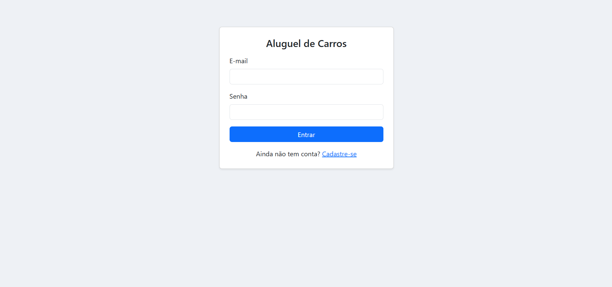 | 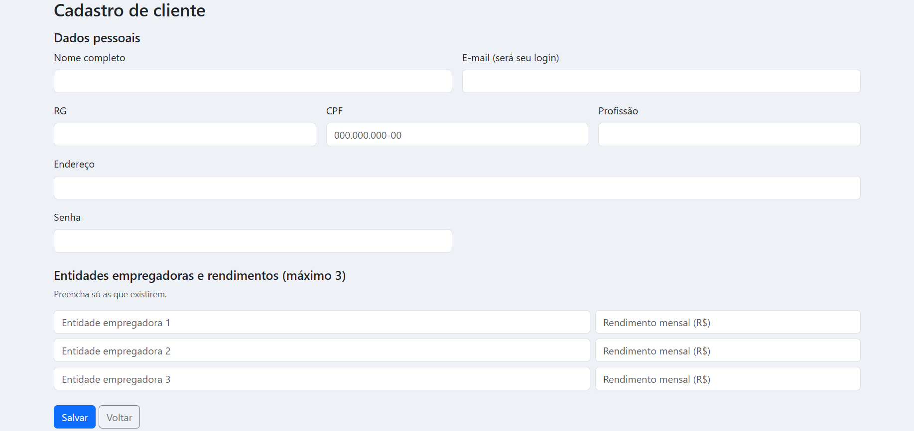 |
| **Home (hero)** | **Home (carrossel e rodapé)** |
|  | 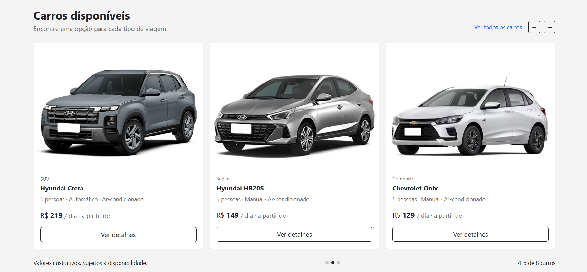 |
| **Catálogo com filtros** | **Card virado (detalhes)** |
| 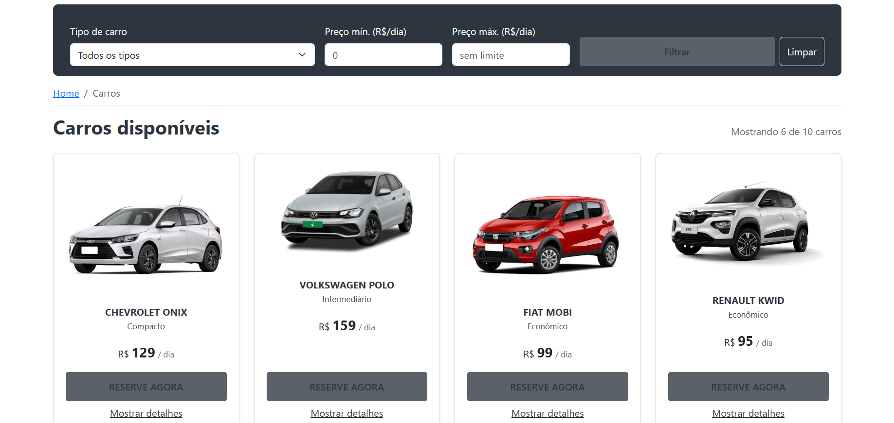 | 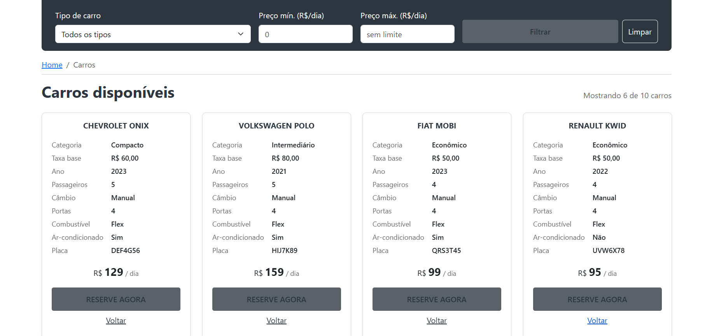 |
| **Novo pedido (carro pré-selecionado e valor calculado)** | **Meus pedidos** |
| 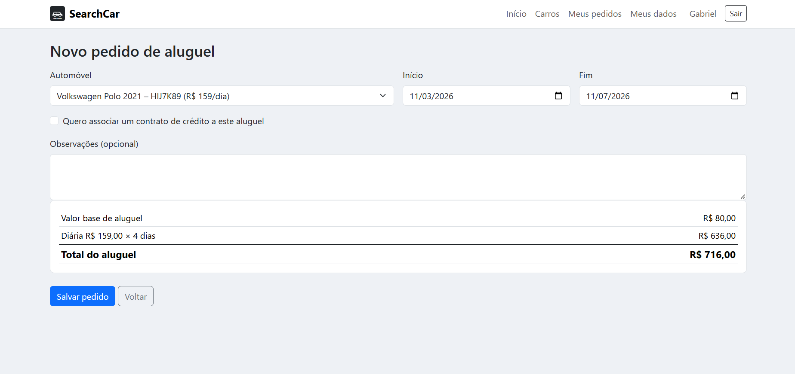 | 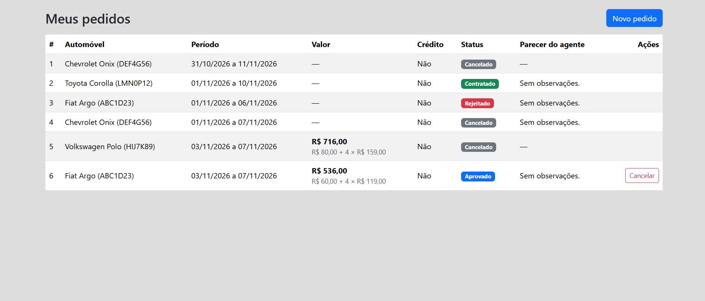 |
| **Lista de clientes (CRUD)** | **Painel do agente** |
| 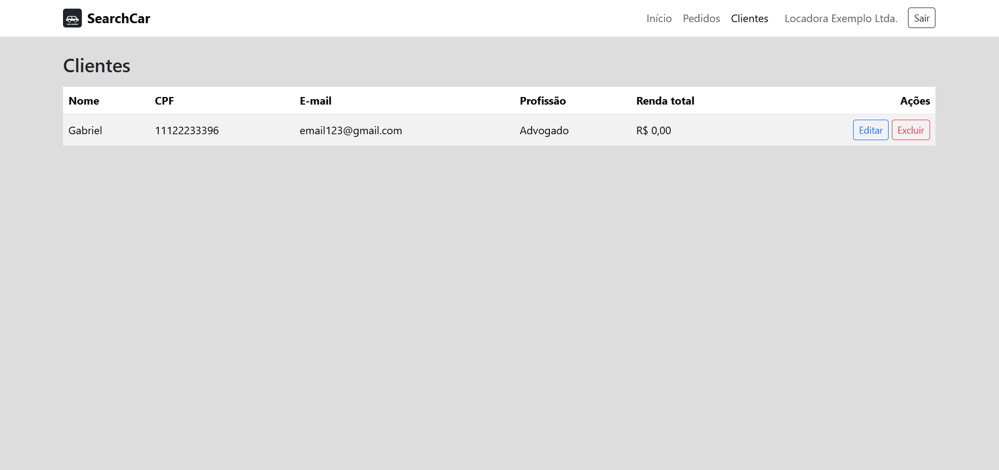 | 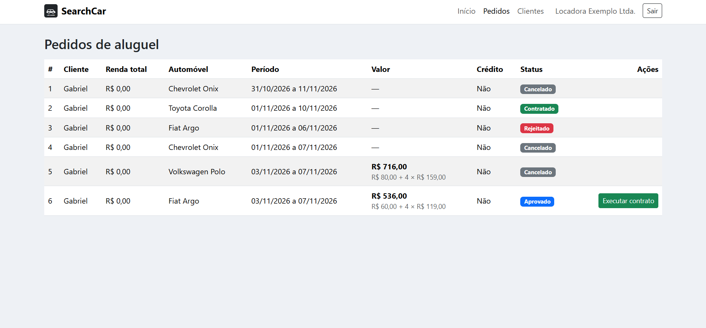 |

**Roteiro de demonstração (sugestão)**
1. Login → cadastro de cliente → CRUD (editar e excluir).
2. Home (recarregar para ver o sorteio) → catálogo: filtros, **Mostrar detalhes** e rolagem infinita.
3. **Reserve agora** → formulário já com o carro escolhido → mudar as datas e ver o **valor atualizar** → salvar → status **Pendente** e valor em *Meus pedidos*.
4. Logar como agente → **Iniciar análise → Aprovar (parecer) → Executar contrato**.
5. Abrir `db.json` e mostrar o automóvel com novo `proprietario`.

### 💻 Exemplo de Saída no Terminal

#### 1. Subindo o JSON Server

```bash
json-server --watch db.json --port 3000
```

```text
  \{^_^}/ hi!

  Loading db.json
  Done

  Resources
  http://localhost:3000/usuarios
  http://localhost:3000/automoveis
  http://localhost:3000/pedidos

  Home
  http://localhost:3000

  Type s + enter at any time to create a snapshot of the database
  Watching...
```

#### 2. Consultando a API (exemplo com cURL)

Lista os SUVs cadastrados:

```bash
curl -X GET 'http://localhost:3000/automoveis?categoria=SUV'
```

**Saída esperada (com o `db.json` inicial):**
```json
[
  {
    "id": 7, "matricula": "MAT-0007", "ano": 2023, "marca": "Jeep", "modelo": "Renegade",
    "placa": "YZA9B01", "proprietario": "empresa", "proprietarioId": 2, "categoria": "SUV",
    "precoDiaria": 199, "valorBase": 120, "passageiros": 5, "cambio": "Automático", "portas": 4,
    "combustivel": "Flex", "arCondicionado": true
  },
  {
    "id": 8, "matricula": "MAT-0008", "ano": 2024, "marca": "Hyundai", "modelo": "Creta",
    "placa": "CDE2F34", "proprietario": "banco", "proprietarioId": 1, "categoria": "SUV",
    "precoDiaria": 219, "valorBase": 120, "passageiros": 5, "cambio": "Automático", "portas": 4,
    "combustivel": "Flex", "arCondicionado": true
  },
  {
    "id": 12, "matricula": "MAT-0012", "ano": 2024, "marca": "Volkswagen", "modelo": "T-Cross",
    "placa": "STU4V56", "proprietario": "empresa", "proprietarioId": 2, "categoria": "SUV",
    "precoDiaria": 229, "valorBase": 120, "passageiros": 5, "cambio": "Automático", "portas": 4,
    "combustivel": "Flex", "arCondicionado": true
  }
]
```

#### 3. Alterando o status de um pedido (PATCH)

```bash
curl -X PATCH 'http://localhost:3000/pedidos/1' \
     -H 'Content-Type: application/json' \
     -d '{"status": "Em análise"}'
```

---

## 🧪 Testes

O projeto **não possui testes automatizados**; a validação foi feita por **testes manuais** seguindo o roteiro abaixo.

| # | Cenário | Resultado esperado |
| :-: | :--- | :--- |
| 1 | Cadastrar cliente com CPF inválido (`111.111.111-11`) | Alerta "CPF inválido." |
| 2 | Cadastrar dois clientes com o mesmo CPF ou e-mail | Alerta de duplicidade no segundo cadastro |
| 3 | Login com senha errada | "E-mail ou senha incorretos." |
| 4 | Login como cliente e como agente | Ambos vão para a home, com menus diferentes |
| 5 | Abrir `catalogo.html` logado como agente | Redireciona para a home |
| 6 | Recarregar a home várias vezes | Carrossel mostra carros em ordem/seleção diferentes |
| 7 | Catálogo sem filtro | Todos os carros disponíveis, na ordem do `db.json` |
| 8 | Filtro por tipo "SUV" e por preço máximo | Apenas carros que atendem ao filtro |
| 9 | Preço mínimo maior que o máximo | Alerta de validação |
| 10 | "Mostrar detalhes" em um card | Só aquele card vira; os outros permanecem |
| 11 | Rolar a página até o fim | Novos lotes de 6 cards entram; mensagem final ao acabar |
| 12 | "Reserve agora" | Formulário abre com o carro já selecionado |
| 13 | Criar pedido e voltar ao catálogo | O carro reservado não aparece mais |
| 14 | Editar pedido pendente / cancelar pedido | Dados atualizados / status "Cancelado" |
| 15 | Agente: analisar → aprovar → contratar | Status evolui e o automóvel muda de `proprietario` |
| 16 | Excluir cliente com pedidos | Exclusão bloqueada com aviso |
| 17 | No formulário, escolher carro e datas | Resumo mostra taxa base, diária × dias e total |
| 18 | Alterar a data de fim (ou o carro) | O total é recalculado na hora |
| 19 | Retirar e devolver no mesmo dia | Conta 1 diária (mínimo) |
| 20 | Salvar o pedido e abrir *Meus pedidos* e o painel do agente | O valor total e a composição aparecem nas duas telas e batem com o formulário |

Para uma evolução futura: testes unitários das funções puras (`validarCPF`, `embaralhar`, `buscarDisponiveis`) com **Vitest/Jest** e testes E2E com **Playwright**.

---

## 🔗 Documentações utilizadas

* 📖 **Bootstrap 5.3 (interface):** [Documentação Oficial do **Bootstrap**](https://getbootstrap.com/docs/5.3/getting-started/introduction/)
* 📖 **API REST simulada:** [**JSON Server** – repositório e documentação](https://github.com/typicode/json-server/tree/v0.17.4)
* 📖 **Consumo da API:** [**Fetch API** (MDN)](https://developer.mozilla.org/pt-BR/docs/Web/API/Fetch_API)
* 📖 **Rolagem infinita:** [**IntersectionObserver** (MDN)](https://developer.mozilla.org/pt-BR/docs/Web/API/Intersection_Observer_API)
* 📖 **Módulos JavaScript:** [**JavaScript modules** (MDN)](https://developer.mozilla.org/pt-BR/docs/Web/JavaScript/Guide/Modules)
* 📖 **Armazenamento de sessão:** [**Web Storage / sessionStorage** (MDN)](https://developer.mozilla.org/pt-BR/docs/Web/API/Window/sessionStorage)
* 📖 **CSS (flip 3D, Grid):** [`transform`](https://developer.mozilla.org/pt-BR/docs/Web/CSS/transform) · [`backface-visibility`](https://developer.mozilla.org/pt-BR/docs/Web/CSS/backface-visibility) · [CSS Grid](https://developer.mozilla.org/pt-BR/docs/Web/CSS/CSS_grid_layout)
* 📖 **Modelagem:** Diagrama de Pacotes (leitura complementar do enunciado)
* 📖 **Guia de Estilo:** [**Conventional Commits** (Padrão de Mensagens)](https://www.conventionalcommits.org/pt-br/v1.0.0/)
* 📖 **Material da disciplina:** Manual de HTML e CSS (AV1) e documentação do Bootstrap disponibilizados no projeto

---

## 👥 Autores

| 👤 Nome | :octocat: GitHub | 💼 LinkedIn | 📤 Gmail |
|---------|-----------------|-------------|-----------|
| Arthur Soares de Carvalho | <div align="center"><a href="https://github.com/SEU_USUARIO"></a></div> | <div align="center"><a href="https://www.linkedin.com/in/arthur-carvalho-3a1s0d7c"></a></div> | <div align="center"><a href="mailto:arthursoarescarvalho7@gmail.com"></a></div> |

---

## 🤝 Contribuição

Sugestões e melhorias são bem-vindas.

1. Faça um `fork` do projeto.
2. Crie uma branch para sua feature (`git checkout -b feature/minha-feature`).
3. Commit suas mudanças (`git commit -m 'feat: adiciona nova funcionalidade X'`). **(Utilize [Conventional Commits](https://www.conventionalcommits.org/pt-br/v1.0.0/))**
4. Faça o `push` para a branch (`git push origin feature/minha-feature`).
5. Abra um **Pull Request (PR)**.

> [!IMPORTANT]
> 📝 **Regras:** mantenha a separação em camadas (páginas → `auth/utils/carros` → `api.js`), não chame `fetch` direto nas páginas e atualize os diagramas em `docs/` quando alterar o modelo.

---

## 📄 Licença

Este projeto é distribuído sob a **[Licença MIT](./LICENSE)**.

---
